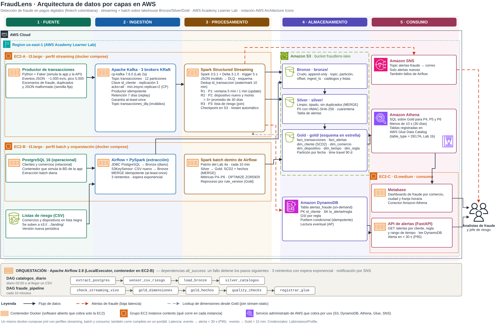

# FraudLens

Detección de fraude en pagos digitales en tiempo real para una billetera digital colombiana (proyecto final de
**ST1630 Sistemas Intensivos en Datos**, Universidad EAFIT, prof. Andrés Sacre Alzate).

Los analistas de riesgo necesitan detectar patrones de fraude en menos de 2 minutos desde la transacción y analizar
el histórico completo para ajustar las reglas, sin afectar la base operacional. El diseño completo está en el
[Entregable 1](docs/entregable1/e1_fraudlens.pdf).

## Arquitectura



Todo corre en **AWS Academy Learner Lab** (us-east-1): el cómputo en contenedores sobre EC2 con un mismo
`docker-compose.yml` y los servicios administrados solo si cobran por uso.

| Capa | Herramienta | Dónde corre |
|---|---|---|
| Fuente | Productor Python/Faker, PostgreSQL 16, CSV de listas de riesgo | EC2-A, EC2-B, S3 `landing/` |
| Ingestión | Apache Kafka 3 brokers (KRaft, `cp-kafka:7.6.0`), Airflow + PySpark | EC2-A, EC2-B |
| Procesamiento | Spark Structured Streaming 3.5.1 + Delta 3.1.0; Spark batch dentro de Airflow | EC2-A, EC2-B |
| Almacenamiento | Delta Lake en Amazon S3 (Bronze/Silver/Gold, esquema en estrella); Amazon DynamoDB (alertas) | AWS |
| Consumo | Amazon Athena + Glue Data Catalog, Amazon SNS, Metabase, API FastAPI | AWS y EC2-C |
| Orquestación | Apache Airflow 2.9 (LocalExecutor): `catalogos_diario` y `fraude_pipeline` | EC2-B |

## Estructura del repositorio

```
FraudLens/
├── docker-compose.yml   ← pendiente (S12): perfiles streaming, batch y consumo
├── .env.example         ← variables de entorno (copiar a .env; nunca subir .env)
├── infra/               ← AWS: bucket S3, tabla DynamoDB, topic SNS, EC2; imágenes Docker
├── producer/            ← productor de transacciones (Python + Faker)
├── streaming/           ← Spark Structured Streaming: Bronze, Silver, reglas R1–R3, alertas
├── batch/               ← Spark batch: catálogos, Gold (esquema en estrella), consultas P4–P6
├── dags/                ← DAG de Airflow
├── api/                 ← API de alertas (FastAPI)
├── dashboards/          ← dashboards de Metabase y consultas de Athena
└── docs/
    ├── entregable1/     ← documento (PDF y .tex), diagrama (.drawio, PNG, SVG) y enlace de draw.io
    ├── entregable2/     ← slides de la sustentación
    └── bitacora_ia.md   ← bitácora de delegación a agentes de IA (obligatoria)
```

## Equipo y responsabilidades

| Integrante | Bloque | Carpetas | Par revisor |
|---|---|---|---|
| Andrés Felipe Vélez Álvarez | Infraestructura e ingestión | `infra/`, `producer/`, `docker-compose.yml` | Samuel Samper Cardona |
| Samuel Samper Cardona | Procesamiento streaming | `streaming/` | Sebastián Salazar Henao |
| Sebastián Salazar Henao | Batch y lakehouse | `batch/` | Hellen Yanes Doria |
| Hellen Yanes Doria | Orquestación y consumo | `dags/`, `api/`, `dashboards/` | Andrés Felipe Vélez Álvarez |

## Forma de trabajo

- Nadie hace push directo a `main`: cada cambio va en una rama (`feat/<bloque>-<tema>`) y entra por Pull Request
  revisado por el par revisor.
- El contrato de datos (esquema JSON del evento y nombres de columnas) se fija en S12 y solo cambia por PR aprobado
  por los dueños afectados.
- Matriz de versiones fija: Spark 3.5.1, Delta Lake 3.1.0, `hadoop-aws` 3.3.4, `cp-kafka` 7.6.0, Airflow 2.9.3,
  Python 3.11. Ninguna imagen con la etiqueta `latest`.
- Cada integrante registra en [`docs/bitacora_ia.md`](docs/bitacora_ia.md) lo que delega a agentes de IA.

## AWS Learner Lab: cuidar el presupuesto (USD 50)

- Detener las EC2 al terminar cada sesión, y también al iniciar una sesión en la que no se usen: el laboratorio las
  vuelve a encender solo.
- No usar IP elásticas, RDS ni snapshots: cobran aunque las instancias estén detenidas.
- Credenciales: las EC2 usan `LabInstanceProfile`; nunca subir llaves ni el archivo `.env` al repositorio.
- Revisar el presupuesto al iniciar cada sesión (AWS Budgets se actualiza cada 8 a 12 horas).

## Cómo correr el pipeline

Pendiente para el Entregable 2: instrucciones para levantar el pipeline desde cero con `docker compose`.
