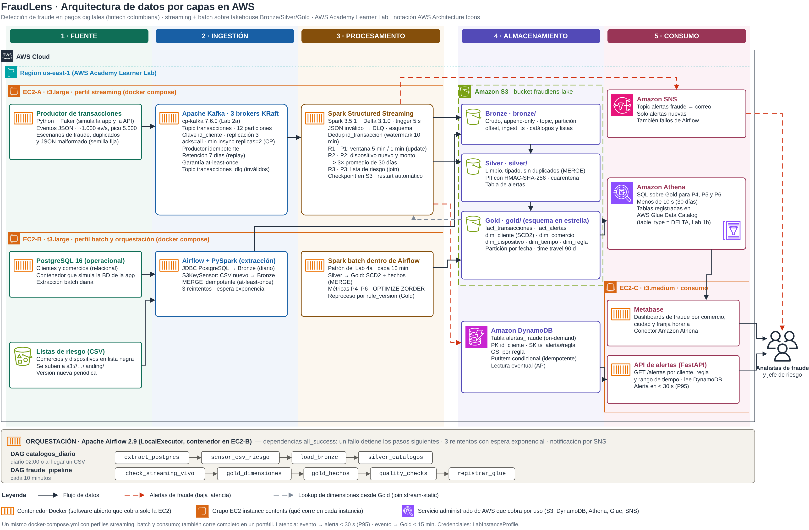

# FraudLens

Detección de fraude en pagos digitales en tiempo real para una billetera digital colombiana (proyecto final de
**ST1630 Sistemas Intensivos en Datos**, Universidad EAFIT, prof. Andrés Sacre Alzate).

Los analistas de riesgo necesitan detectar patrones de fraude en menos de 2 minutos desde la transacción y analizar el
histórico completo para ajustar las reglas, sin afectar la base operacional. El diseño está en el
[Entregable 1](docs/entregable1/e1_fraudlens.pdf); este repositorio es la implementación (Entregable 2).

## Arquitectura



```
productor ──► Kafka (3 brokers, key=id_cliente) ──► Spark Structured Streaming ──► Bronze ─► Silver (Delta, S3/MinIO)
                    └─► DLQ (JSON ilegible)              │  validación + cuarentena          │
                                                         ├─ R1 (ventana 5 min/1 min), R2, R3 │
                                                         └─► alertas: DynamoDB (+SNS) y Silver
PostgreSQL + CSV de riesgo ─► Airflow `catalogos_diario` ─► Bronze/Silver (clientes con HMAC, comercios, lista de riesgo)
Airflow `fraude_pipeline` (cada 10 min): Silver ─► Gold (estrella) ─► calidad ─► OPTIMIZE/Glue
API FastAPI  ◄── DynamoDB      Athena/Metabase (AWS) o `batch.consultas` (local) ◄── Gold
```

| Capa | Herramienta | Código |
|---|---|---|
| Fuente | Productor Python, PostgreSQL 16, CSV de listas de riesgo | `producer/`, `infra/postgres/` |
| Ingestión | Kafka 3 brokers KRaft (`cp-kafka:7.6.0`, `acks=all`, `min.insync.replicas=2`, 12 particiones) | `docker-compose.yml` |
| Procesamiento | Spark 3.5.1 Structured Streaming + Delta Lake 3.1.0 | `streaming/`, `common/` |
| Batch y Gold | Spark batch (catálogos, estrella, calidad, reproceso) | `batch/` |
| Orquestación | Airflow 2.9 (LocalExecutor): `catalogos_diario`, `fraude_pipeline` | `dags/` |
| Alertas | DynamoDB (+ índices por cliente y por regla), SNS | `common/alerts.py`, `infra/aws/` |
| Consumo | API FastAPI, consultas P4–P6 (Athena/Spark SQL) | `api/`, `dashboards/athena/`, `batch/consultas.py` |

## Reglas de fraude

| Regla | v1 | v2 (para reprocesar) |
|---|---|---|
| R1 ráfaga/monto | más de 5 transacciones o más de $2.000.000 en 5 min (ventana deslizante de 1 min) | más de 4 o más de $1.500.000 |
| R2 dispositivo nuevo | dispositivo nunca usado por el cliente y monto > 3× su promedio de 30 días | 2,5× |
| R3 lista de riesgo | comercio o dispositivo en la última versión de la lista | igual |

## Cómo correrlo desde cero (local, con Docker)

Requisitos: Docker con Compose v2 y unos **8 GB de RAM** libres para Docker. La imagen de MinIO es la pública de Chainguard
(`minio/minio` ya no se publica en Docker Hub); se cambia con `MINIO_IMAGE` en `.env`.

```bash
git clone https://github.com/AndresVelez31/FraudLens.git && cd FraudLens
cp .env.example .env
# Edita .env: POSTGRES_PASSWORD y PII_HMAC_KEY son obligatorios (por ejemplo: openssl rand -hex 24)
docker compose up -d --build        # la primera vez baja imágenes y jars (varios minutos)
docker compose ps                   # kafka-init y setup quedan en "Exited (0)": es lo esperado
```

`setup` crea el bucket, la tabla de DynamoDB, siembra PostgreSQL (20.000 clientes, 300 comercios + 10 de riesgo) y deja la
lista de riesgo v1 en `landing/listas_riesgo/`. El streaming arranca solo y queda escuchando el topic `transacciones`.

**Demo paso a paso**

```bash
# 1) Cargar catálogos (Airflow: http://localhost:8081, usuario admin / AIRFLOW_ADMIN_PASSWORD o "admin")
docker compose exec airflow-scheduler airflow dags trigger catalogos_diario

# 2) Tráfico normal + ráfaga R1 + registros malos (2 min)
docker compose run --rm producer python -m producer.producer --escenario mixto --rate 50 --duracion 120

# 3) Escenarios con respuesta conocida (cada uno escribe su ground truth en --verdad)
docker compose run --rm producer python -m producer.producer --escenario r2-base
docker compose exec airflow-scheduler airflow dags trigger fraude_pipeline      # Gold: alimenta el perfil que usa R2
docker compose run --rm producer python -m producer.producer --escenario r2 --verdad /tmp/verdad.jsonl
docker compose run --rm producer python -m producer.producer --escenario r3

# 4) Ver alertas
curl "http://localhost:8080/alertas?regla=R1&limite=5"
curl "http://localhost:8080/alertas?id_cliente=C0000123"

# 5) Consultas P4–P6 sobre Gold y reproceso con otra versión de reglas
docker compose run --rm streaming python -m batch.consultas todas
docker compose run --rm streaming python -m batch.reproceso --desde $(date -u +%F) --hasta $(date -u +%F) --rule-version v2
```

Consolas: MinIO http://localhost:9001 (lake), Airflow http://localhost:8081, API http://localhost:8080/docs.
Apagar: `docker compose down` (conserva datos) o `docker compose down -v` (borra todo).

### Demostrar tolerancia a fallos
* **Job de streaming:** `docker compose kill -s KILL streaming && docker compose up -d streaming` → retoma desde el
  checkpoint; Silver y alertas no se duplican (MERGE por llave + `id_alerta` determinista + PutItem condicional).
* **Un broker de Kafka:** `docker compose stop kafka-3` → el productor sigue publicando (`min.insync.replicas=2`);
  con dos brokers caídos el productor se detiene en lugar de perder datos (CP).
* **Fallo de una tarea de Airflow:** 3 reintentos con espera exponencial y aviso por SNS (si hay `SNS_TOPIC_ARN`).

## Pruebas

```bash
pip install -r infra/docker/requirements.txt pytest moto[server] httpx
export PYSPARK_PYTHON=$(which python)   # si tienes varias versiones de Python
pytest tests/                       # lógica de streaming, seudonimización HMAC y API (sin Kafka ni Docker)
```

`tests/e2e_local.py` recorre el flujo completo **sin Docker** (Kafka de 1 broker con `tests/kafka_local.sh`, DynamoDB
simulado con moto, lakehouse en disco) y comprueba contra respuestas conocidas: Bronze = producido; Silver = producido −
ilegibles − cuarentena; alertas R1/R2/R3 exactas y sin falsos positivos; DLQ; duplicados; `kill -9` sin duplicados;
lista de riesgo v2; calidad; P4–P6; reproceso con v2.

### Qué se probó y qué no (honestidad técnica)

| Probado | No probado en el entorno de desarrollo |
|---|---|
| **Con Docker real** (3 brokers de Kafka, MinIO, DynamoDB Local, PostgreSQL, Airflow, API): `docker compose up` levanta; el streaming genera alertas R1/R3 y el DLQ recibe el JSON roto; la API responde; `catalogos_diario` (JDBC + S3A) y `fraude_pipeline` terminan en éxito; consultas P4–P6; con un broker caído el productor no pierde mensajes; `kill -9` al streaming no duplica alertas | Despliegue en AWS (S3, DynamoDB, SNS reales y el LabInstanceProfile) |
| Prueba end-to-end sin Docker con respuestas conocidas (R2 5/5, R1 sin falsos positivos, duplicados, reproceso con v2) | Athena/Glue y Metabase |
| Pruebas unitarias (`pytest`, 15) y seudonimización HMAC-SHA-256 | Latencia en una máquina de 4+ vCPU |

Si algo falla al primer `docker compose up` en su máquina, lo más probable es de empaquetado (red, versión de un jar, permisos de
volumen, memoria): `docker compose logs <servicio>`.

**Latencia medida (sandbox de 2 núcleos, prueba e2e completa):** evento → alerta, R1 ≈ 11 s; R2 y R3 entre ≈ 22 s y 65 s
(el máximo incluye lotes acumulados tras reiniciar el job y Spark compitiendo por 2 núcleos). Cumple la meta de 2 min, pero
**no** garantiza el P95 < 30 s del RNF en ese hardware. En una EC2 de 4+ vCPU debería mejorar; **hay que medirlo en la
demo** con `python -m batch.consultas p5` y actualizar este párrafo.

## Pasar a AWS (Learner Lab)

El código no cambia, solo variables de entorno (`.env`):

| Variable | Local | AWS |
|---|---|---|
| `S3_ENDPOINT` | `http://minio:9000` | *(vacía)* |
| `S3_BUCKET` | `fraudlens-lake` | bucket real (`python infra/aws/crear_recursos.py --todo`) |
| `DYNAMODB_ENDPOINT` | `http://dynamodb:8000` | *(vacía)* |
| `SNS_TOPIC_ARN` | *(vacía: solo log)* | ARN del topic |
| `AWS_ACCESS_KEY_ID/SECRET` | `minioadmin` | usar el `LabInstanceProfile` de la EC2 (quitar las claves) |

Pasos: EC2 (hasta *large*) con Docker → clonar → `.env` → `python infra/aws/crear_recursos.py --todo --email <correo>` →
`docker compose up -d --build`. Athena lee Gold registrado en Glue (`python -m batch.publicar glue`, tarea del DAG).
Metabase se conecta a Athena en AWS (no está en el compose local: no puede leer Delta); en local las preguntas P4–P6
se responden con `batch.consultas`.

## Decisiones y diferencias respecto al E1

* **Notificaciones SNS: at-most-once.** Solo se notifican alertas recién creadas en DynamoDB; si el job muere entre el
  PutItem y el publish, esa alerta existe pero no se notificó. Se prefirió no duplicar avisos al analista.
* **Duplicados:** se elimina el reenvío idéntico (`id_transaccion` + `fecha`); Bronze conserva todo lo recibido.
* **R2 en reproceso es "as-of":** dispositivo nuevo = primera vez que el cliente lo usó; promedio de los 30 días previos
  a cada transacción.
* **Datos personales:** nombre, documento, teléfono y correo solo existen en PostgreSQL; en el lake entran con
  HMAC-SHA-256 (clave en `.env`, fuera del repositorio).
* **Gold** en estrella con `dim_cliente` SCD2; historial Delta de 90 días (viaje en el tiempo) y `OPTIMIZE ZORDER`.
* **CAP:** Kafka y S3 favorecen consistencia; las lecturas de DynamoDB son eventualmente consistentes (AP) y la API lo declara.

## Estructura del repositorio

```
FraudLens/
├── docker-compose.yml   ← todo el pipeline local (Kafka×3, MinIO, DynamoDB Local, PostgreSQL, Spark, Airflow, API)
├── .env.example         ← variables (copiar a .env; nunca subir .env)
├── common/              ← núcleo compartido: config, Spark, esquema, PII, reglas, alertas, tablas Delta
├── streaming/           ← job de Structured Streaming (Bronze, Silver, R1–R3, alertas)
├── batch/               ← catálogos, Gold, calidad, reproceso, publicación, consultas P4–P6
├── dags/                ← DAG catalogos_diario y fraude_pipeline
├── producer/            ← productor y catálogo sintético (con ground truth)
├── api/                 ← API de alertas
├── dashboards/athena/   ← SQL de P4–P6 (Athena y Spark SQL)
├── infra/               ← Dockerfiles, init.sql de PostgreSQL, creación de recursos AWS
├── tests/               ← pytest y prueba end-to-end sin Docker
└── docs/                ← E1, bitácora de IA, E2 (slides y guía de defensa)
```

## Equipo
Andrés Felipe Vélez Álvarez · Samuel Samper Cardona · Sebastián Salazar Henao · Hellen Yanes Doria.
Uso de agentes de IA: ver [docs/bitacora_ia.md](docs/bitacora_ia.md).
