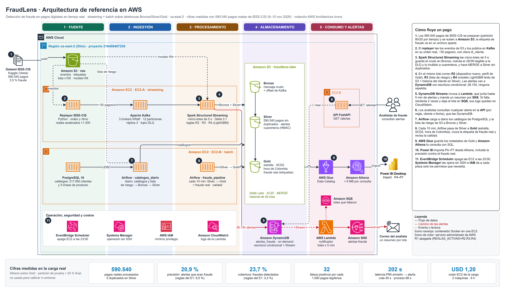

# FraudLens

Detección de fraude en pagos digitales en tiempo real para una billetera digital colombiana (proyecto final de
**ST1630 Sistemas Intensivos en Datos**, Universidad EAFIT, prof. Andrés Sacre Alzate).

Los analistas de riesgo necesitan detectar patrones de fraude en menos de 2 minutos desde la transacción y analizar el
histórico completo para ajustar las reglas, sin afectar la base operacional. El diseño está en el
[Entregable 1](docs/entregable1/e1_fraudlens.pdf); este repositorio es la implementación (Entregable 2), probada en AWS
con 590.540 pagos reales de IEEE-CIS.

**Entregable 2:** slides en [docs/entregable2/FraudLens_E2.pdf](docs/entregable2/FraudLens_E2.pdf), guion de la demo en
vivo en [docs/entregable2/demo.md](docs/entregable2/demo.md), guía de defensa, estado del arte y cambios frente al E1
en [docs/entregable2/](docs/entregable2/README.md).

**Resultado en la partición de prueba:** 20,9 % de precisión y 23,7 % de cobertura (reglas del E1: 6,5 % y 3,3 %),
32 falsos positivos por cada 1.000 pagos legítimos, 0 alertas repetidas. Latencia P95 de ~202 s: no cumple la meta de
30 s (causa y arreglo en [cambios_frente_e1.md](docs/entregable2/cambios_frente_e1.md)).

## Arquitectura



Editable en [docs/entregable2/arquitectura.drawio](docs/entregable2/arquitectura.drawio). El diagrama del E1 sigue en
`docs/entregable1/`.

```
replayer IEEE-CIS ─► Kafka (3 brokers, key=id_cliente) ─► Spark Structured Streaming ─► Bronze ─► Silver (Delta, S3)
                          └─► DLQ (JSON ilegible)            │  validación + cuarentena
                                                             ├─ R2, R3 (join con Gold) y R4 (LightGBM); R1 apagable
                                                             └─► alertas: Silver y DynamoDB (escritura condicional)
DynamoDB Streams ─► Lambda notificador ─► SNS (un correo resumen por lote); lotes fallidos ─► SQS
PostgreSQL + CSV de riesgo ─► Airflow `catalogos_diario` ─► Bronze/Silver (clientes con HMAC, comercios, lista de riesgo)
Airflow `fraude_pipeline` (cada 10 min): Silver ─► Gold (estrella) ─► calidad ─► Glue
Gold ─► Athena ─► Power BI (Import);  API FastAPI ◄── DynamoDB
```

| Capa | Herramienta | Código |
|---|---|---|
| Fuente | Productor Python, PostgreSQL 16, CSV de listas de riesgo | `producer/`, `infra/postgres/` |
| Ingestión | Kafka 3 brokers KRaft (`cp-kafka:7.6.0`, `acks=all`, `min.insync.replicas=2`, 12 particiones) | `docker-compose.yml` |
| Procesamiento | Spark 3.5.1 Structured Streaming + Delta Lake 3.1.0 | `streaming/`, `common/` |
| Batch y Gold | Spark batch (catálogos, estrella, calidad, reproceso) | `batch/` |
| Orquestación | Airflow 2.9 (LocalExecutor): `catalogos_diario`, `fraude_pipeline` | `dags/` |
| Alertas | DynamoDB (+ índices por cliente y por regla), Lambda notificador desde DynamoDB Streams, SNS, SQS de fallos | `common/alerts.py`, `lambdas/notificador/`, `infra/aws/` |
| Modelo | LightGBM (regla R4), entrenado con la partición temporal 80/20 | `ml/`, `common/r4.py`, `common/variables.py` |
| Consumo | Power BI (modo Import sobre Athena), API FastAPI, consultas P4–P7 (Athena/Spark SQL) | `dashboards/`, `api/`, `batch/consultas.py` |

## Reglas de fraude

La versión de reglas se elige con `RULE_VERSION` y las reglas activas con `REGLAS_ACTIVAS`, sin tocar código. En AWS,
con IEEE-CIS, corren `RULE_VERSION=ieee` y `REGLAS_ACTIVAS=R2,R3,R4`.

| Regla | ieee (AWS, datos reales) | v1 (datos sintéticos) | v2 (para reprocesar) |
|---|---|---|---|
| R1 ráfaga/monto | 3 o más pagos en 5 min; **apagada** (casi no acierta con datos reales) | más de 5 transacciones o más de $2.000.000 en 5 min (ventana deslizante de 1 min) | más de 4 o más de $1.500.000 |
| R2 dispositivo nuevo | dispositivo nunca usado por el cliente y monto > 1,5× su promedio de 30 días | igual, con 3× | 2,5× |
| R3 lista de riesgo | comercio o dispositivo en la lista `riesgo_v100` (aprendida con el 80 % inicial) | última versión de la lista | igual |
| R4 modelo | LightGBM con 17 variables del pago y de la historia del cliente; alerta si el puntaje supera 0,155 | igual | igual |

Precisión de cada regla en la partición de prueba: R4 22,2 %, R3 18,6 %, R2 13,4 %.

## Cómo correrlo desde cero (local, con Docker)

Requisitos: Docker con Compose v2 y unos **8 GB de RAM** libres para Docker.

La configuración está en dos archivos:

| Archivo | Qué tiene |
|---|---|
| `docker-compose.yml` | Todos los servicios, pensados para AWS: sin llaves, con S3, DynamoDB y SNS reales. Se dividen en dos perfiles: `streaming` (Kafka, streaming, productor) y `batch` (PostgreSQL, Airflow, API). |
| `compose.local.yml` | Se suma al anterior en local: agrega MinIO (como S3) y DynamoDB Local, y les pone sus llaves de prueba. |

```bash
git clone https://github.com/AndresVelez31/FraudLens.git && cd FraudLens
cp .env.example .env
# Edita .env: POSTGRES_PASSWORD y PII_HMAC_KEY son obligatorios (por ejemplo: openssl rand -hex 24).
# Descomenta las dos líneas de la opción "Local" (COMPOSE_FILE y COMPOSE_PROFILES); en Windows usa ";" en COMPOSE_FILE.
docker compose up -d --build        # la primera vez baja imágenes y jars (varios minutos)
docker compose ps                   # kafka-init y setup quedan en "Exited (0)": es lo esperado
```

Con `COMPOSE_FILE` y `COMPOSE_PROFILES` en el `.env`, todos los comandos `docker compose` de este README funcionan sin
escribir `-f` ni `--profile`.

`setup` crea el bucket y la tabla de DynamoDB (solo en local), siembra PostgreSQL (20.000 clientes, 300 comercios + 10 de
riesgo) y deja la lista de riesgo v1 en `landing/listas_riesgo/`. El streaming arranca solo y queda escuchando el topic
`transacciones`.

**Demo guiada (Windows, PowerShell)**

`scripts/demo.ps1` recorre todo el sistema con una pausa antes de cada paso para explicarlo: catálogos, tráfico con
fraude, alertas R1/R2/R3 en la API, capas del lakehouse, preguntas P4–P6 y tolerancia a fallos. Al final muestra un
resumen con lo esperado contra lo obtenido.

```powershell
powershell -ExecutionPolicy Bypass -File scripts\demo.ps1              # con pausas (para presentar)
powershell -ExecutionPolicy Bypass -File scripts\demo.ps1 -SinPausas   # todo seguido (para ensayar)
powershell -ExecutionPolicy Bypass -File scripts\demo.ps1 -SinFallos   # sin el paso de tolerancia a fallos
```

**Demo paso a paso (comandos sueltos)**

```bash
# 1) Cargar catálogos (Airflow: http://localhost:8081, usuario admin / AIRFLOW_ADMIN_PASSWORD o "admin")
docker compose exec airflow-scheduler airflow dags trigger catalogos_diario

# 2) Tráfico normal + ráfaga R1 + registros malos (2 min)
docker compose run --rm producer python -m producer.producer --escenario mixto --rate 50 --duracion 120

# 3) Escenarios con respuesta conocida (cada uno escribe su ground truth en --verdad)
docker compose run --rm producer python -m producer.producer --escenario r2-base
docker compose exec airflow-scheduler airflow dags trigger fraude_pipeline      # Gold: alimenta el perfil que usa R2
docker compose run --rm producer python -m producer.producer --escenario r2 --verdad /tmp/verdad.jsonl
docker compose run --rm producer python -m producer.producer --escenario r3

# 4) Ver alertas
curl "http://localhost:8080/alertas?regla=R1&limite=5"
curl "http://localhost:8080/alertas?id_cliente=C0000123"

# 5) Consultas P4–P6 sobre Gold y reproceso con otra versión de reglas
docker compose run --rm streaming python -m batch.consultas todas
docker compose run --rm streaming python -m batch.reproceso --desde $(date -u +%F) --hasta $(date -u +%F) --rule-version v2
```

Consolas: MinIO http://localhost:9001 (lake), Airflow http://localhost:8081, API http://localhost:8080/docs.
Apagar: `docker compose down` (conserva datos) o `docker compose down -v` (borra todo).

### Demostrar tolerancia a fallos
* **Job de streaming:** `docker compose kill -s KILL streaming && docker compose up -d streaming` → retoma desde el
  checkpoint; Silver y alertas no se duplican (MERGE por llave + `id_alerta` determinista + PutItem condicional).
* **Un broker de Kafka:** `docker compose stop kafka-3` → el productor sigue publicando (`min.insync.replicas=2`);
  con dos brokers caídos el productor se detiene en lugar de perder datos (CP).
* **Fallo de una tarea de Airflow:** 3 reintentos con espera exponencial y aviso por SNS (si hay `SNS_TOPIC_ARN`).

## Datos reales: IEEE-CIS

FraudLens usa transacciones reales de **IEEE-CIS Fraud Detection** (Vesta, Kaggle): 590.540 transacciones con
3,50 % de fraude etiquetado, en 182 días. Ficha completa y supuestos del mapeo: [docs/datos/ieee-cis.md](docs/datos/ieee-cis.md).

1. **Descargar** `train_transaction.csv` y `train_identity.csv` desde Kaggle (hay que aceptar las reglas de la
   competencia) en `data/ieee-cis/`. La carpeta `data/` no se sube al repositorio ni entra a las imágenes de Docker.
2. **Perfilar y preparar** (necesita `pip install pandas boto3`):
   ```bash
   python scripts/perfil_ieee.py --datos data/ieee-cis        # cifras -> docs/datos/ieee-cis-perfil.json
   python scripts/preparar_ieee.py --datos data/ieee-cis --destino s3a://<bucket>   # prepara y sube al lake
   ```
   Genera los eventos (sin la etiqueta), las etiquetas aparte, la partición temporal 80/20, catálogos y la lista de
   riesgo `riesgo_v100.csv`: 43 dispositivos aprendidos solo con el 80 % inicial. En el 20 % final esa lista acierta
   el 18,6 % de sus alertas, unas 5 veces la tasa base. Para MinIO local, antes de `--destino`:
   `S3_ENDPOINT=http://localhost:9000 AWS_ACCESS_KEY_ID=minioadmin AWS_SECRET_ACCESS_KEY=minioadmin AWS_REGION=us-east-1`.
3. **Catálogos reales en PostgreSQL**: con `CATALOGOS_ORIGEN=s3a://<bucket>/raw/ieee-cis/preparado/catalogos` en
   `.env`, el servicio `setup` reemplaza los clientes sintéticos por los 217.850 de IEEE-CIS (sin `CATALOGOS_ORIGEN`
   sigue sembrando los sintéticos). A mano: `python -m producer.catalogo --postgres --desde-csv <carpeta> --reemplazar`.
4. **Cargar la lista** con el DAG `catalogos_diario` y **reproducir** las transacciones:
   ```bash
   docker compose run --rm --no-deps producer python -m producer.replayer --particion prueba --limite 20000 --factor 1300
   ```
   `--factor 1300` reproduce el ritmo real acelerado (~50 eventos/s); `--factor 0 --tasa-max 200` envía lo más rápido
   posible con tope; `--malos-pct 1` inyecta registros dañados para probar la DLQ y la cuarentena.

**Gold con datos históricos.** Como los pagos reproducidos tienen fecha de 2026-05 a 2026-10 pero llegan hoy, Gold
procesa de forma incremental por **hora de llegada** (`ingest_ts`), no por fecha del pago; el promedio de 30 días de
R2 se cuenta desde el **último pago de Silver** (el reloj de los datos), y `id_tiempo`, hora y franja del día están en
**hora de Colombia** (`ZONA_HORARIA`). En operación normal los dos relojes coinciden y nada cambia.

**Prueba local** (5.000 transacciones del 20 % final, 1 % dañadas): 0 transacciones reales en cuarentena, los 43
registros inválidos inyectados en cuarentena con su motivo, los 13 ilegibles en la DLQ y exactamente las 21 alertas R3
esperadas (5 de ellas son fraude real).

## Pruebas

```bash
pip install -r infra/docker/requirements.txt pytest moto[server] httpx
export PYSPARK_PYTHON=$(which python)   # si tienes varias versiones de Python
pytest tests/                       # lógica de streaming, seudonimización HMAC y API (sin Kafka ni Docker)
```

`tests/e2e_local.py` recorre el flujo completo **sin Docker** (Kafka de 1 broker con `tests/kafka_local.sh`, DynamoDB
simulado con moto, lakehouse en disco) y comprueba contra respuestas conocidas: Bronze = producido; Silver = producido −
ilegibles − cuarentena; alertas R1/R2/R3 exactas y sin falsos positivos; DLQ; duplicados; `kill -9` sin duplicados;
lista de riesgo v2; calidad; P4–P6; reproceso con v2.

### Qué se probó y qué no (honestidad técnica)

| Probado | No probado |
|---|---|
| **En AWS con datos reales:** 590.540 pagos de IEEE-CIS en ~3 h; Silver con 590.540 filas exactas tras 206 reenvíos del replayer; 28.154 alertas sin repetidas; Gold, Glue, Athena y Power BI; Lambda notificador con su camino de fallos a SQS | Carga sostenida de 5.000 pagos/s (RNF-01): se probó a ~50 pagos/s |
| **Con Docker local** (3 brokers de Kafka, MinIO, DynamoDB Local, PostgreSQL, Airflow, API): `docker compose up` levanta; alertas, DLQ, API, los dos DAG y P4–P6; con un broker caído el productor no pierde mensajes; `kill -9` al streaming no duplica alertas | Latencia P95 < 30 s con R4 activa (se midió ~202 s; ver abajo) |
| Prueba end-to-end sin Docker con respuestas conocidas (R2 5/5, R1 sin falsos positivos, duplicados, reproceso con v2) y pruebas unitarias (`pytest tests/`) | |

Si algo falla al primer `docker compose up` en su máquina, lo más probable es de empaquetado (red, versión de un jar, permisos de
volumen, memoria): `docker compose logs <servicio>`.

**Latencia medida en AWS (carga real, P5):** desde que el pago se emite hasta la alerta, mediana 109 s y P95 ~202 s.
Por tramos: envío a Kafka ~0 s, espera en Kafka ~45 s y procesamiento del lote ~68 s. **No cumple** el P95 < 30 s del
RNF-04. La causa: R4 lee de Silver la historia de los clientes de cada lote. El arreglo es una tabla de estado por
cliente. Las consultas de Athena sí cumplen: ~3 s leyendo menos de 6 MB.

## Despliegue en AWS (plan gratuito, us-east-2)

El proyecto corre en un proyecto de AWS en el plan gratuito, región **us-east-2**. Kinesis, MSK y Firehose no están
disponibles en ese plan, así que Kafka corre en contenedores sobre la EC2.

**Recursos que ya existen** (creados una vez desde la consola): bucket `fraudlens-lake-216408407230`, base de Glue y
workgroup de Athena `fraudlens` (límite de 1 GB por consulta), tabla DynamoDB `alertas_fraude` (con Streams y TTL), topic
SNS `alertas-fraude`, rol `fraudlens-ec2` y grupo de seguridad `fraudlens-sg`. La Lambda `fraudlens-notificador`,
su cola SQS de fallos `fraudlens-notificador-fallos` y la conexión con DynamoDB Streams se despliegan con
`AWS_PROFILE=fraudlens bash infra/aws/notificador.sh` (idempotente).
`python infra/aws/crear_recursos.py --todo` crea la base de esos recursos en un proyecto nuevo.

**Dos EC2 m7i-flex.large** (2 vCPU, 8 GB, elegibles en el plan gratuito), en la misma subred, con el perfil de instancia
`fraudlens-ec2`, el grupo `fraudlens-sg`, disco EBS cifrado y metadatos IMDSv2 con **hop limit 2** (sin eso, los
contenedores no pueden leer las credenciales del rol):

| Máquina | `COMPOSE_PROFILES` en `.env` | Qué corre |
|---|---|---|
| EC2-A | `streaming` | 3 brokers de Kafka (512 MB de heap cada uno), Spark Structured Streaming, productor |
| EC2-B | `batch` | PostgreSQL, Airflow (con Spark batch dentro) y la API |

Al lanzar cada EC2 se pega `infra/aws/user-data.sh` en **User data**: instala Docker, Compose y Buildx y clona `main` en
`/opt/fraudlens`. Después, por Session Manager (sin SSH), **empezando siempre con `sudo -i`**, porque el usuario de
Session Manager no está en el grupo `docker`:

```bash
sudo -i
cd /opt/fraudlens && cp .env.example .env
# completar POSTGRES_PASSWORD y PII_HMAC_KEY (la MISMA clave PII en las dos EC2) y descomentar el perfil de esa máquina
# con IEEE-CIS: RULE_VERSION=ieee, REGLAS_ACTIVAS=R2,R3,R4, NOTIFICAR_DESDE=lambda, STARTING_OFFSETS=latest
docker compose up -d --build
```

No se ponen llaves de AWS en ningún lado: boto3 y Spark toman las credenciales del rol de la instancia. Para actualizar
una EC2 después de un cambio en `main`: `cd /opt/fraudlens && git pull && docker compose up -d --build`.

Las EC2 se detienen solas todos los días a las 11:00 p. m. (hora de Colombia) con el horario `fraudlens-apagar-ec2` de
EventBridge Scheduler; al encenderlas, los contenedores arrancan solos y el streaming retoma desde su checkpoint.

**Permisos del rol `fraudlens-ec2` para registrar Gold en Glue:** `glue:GetDatabase`, `glue:GetTable`, `glue:GetTables`,
`glue:CreateTable`, `glue:UpdateTable`, `glue:DeleteTable` y `glue:GetPartitions` sobre la base `fraudlens`. `DeleteTable`
hace falta para reparar las entradas que deja Athena cuando un registro falla.

Athena lee Gold registrado en Glue (`python -m batch.publicar glue`, tarea del DAG `fraude_pipeline`); Power BI se conecta
a Athena en modo Import (`dashboards/powerbi/`, guía en `dashboards/README.md`). En local las preguntas P4–P7 se
responden con `batch.consultas` (P7: acierto contra el fraude real).

**Demo en vivo en AWS:** `bash scripts/demo_aws.sh` enciende las EC2, manda pagos, muestra Spark, las alertas, el DAG
y las consultas de Gold, todo por Systems Manager desde el portátil. Guion de 8 minutos en
[docs/entregable2/demo.md](docs/entregable2/demo.md).

## Decisiones y diferencias respecto al E1

Lista completa de cambios, con su porqué y el estado de cada requisito no funcional:
[docs/entregable2/cambios_frente_e1.md](docs/entregable2/cambios_frente_e1.md). Lo principal:

* **Datos reales y medición:** IEEE-CIS en lugar del productor sintético; partición temporal 80/20 y acierto medido
  contra la etiqueta, que nunca pasa por Kafka.
* **Reglas:** versión `ieee` calibrada, R4 con LightGBM y R1 apagada.
* **Notificaciones:** DynamoDB Streams → Lambda → un correo resumen por lote; si falla tras 2 reintentos, el lote queda
  en SQS. Spark ya no espera a SNS.
* **Consumo:** Power BI en modo Import sobre Athena en lugar de Metabase.
* **Duplicados:** se elimina el reenvío idéntico (`id_transaccion` + `fecha`); Bronze conserva todo lo recibido.
* **R2 en reproceso es "as-of":** dispositivo nuevo = primera vez que el cliente lo usó; promedio de los 30 días previos
  a cada transacción.
* **Datos personales:** nombre, documento, teléfono y correo solo existen en PostgreSQL; en el lake entran con
  HMAC-SHA-256 (clave en `.env`, fuera del repositorio).
* **Gold** en estrella con `dim_cliente` SCD2; historial Delta de 90 días (viaje en el tiempo) y `OPTIMIZE ZORDER`.
* **CAP:** Kafka y S3 favorecen consistencia; las lecturas de DynamoDB son eventualmente consistentes (AP) y la API lo declara.

## Estructura del repositorio

```
FraudLens/
├── docker-compose.yml   ← todos los servicios, con perfiles streaming (EC2-A) y batch (EC2-B)
├── compose.local.yml    ← se suma en local: MinIO (como S3) y DynamoDB Local
├── .env.example         ← variables (copiar a .env; nunca subir .env)
├── common/              ← núcleo compartido: config, Spark, esquema, PII, reglas, R4, variables, alertas, tablas Delta
├── streaming/           ← job de Structured Streaming (Bronze, Silver, DLQ, cuarentena, R1–R4, alertas)
├── batch/               ← catálogos, Gold, calidad, reproceso, publicación en Glue, consultas P4–P7
├── dags/                ← DAG catalogos_diario y fraude_pipeline
├── producer/            ← replayer de IEEE-CIS y productor sintético (con ground truth)
├── ml/                  ← entrenamiento del LightGBM de R4 y comparación de enfoques
├── lambdas/notificador/ ← Lambda que manda el correo resumen desde DynamoDB Streams
├── api/                 ← API de alertas
├── dashboards/          ← SQL de P4–P7 (Athena y Spark SQL) y el reporte de Power BI
├── infra/               ← Dockerfiles, init.sql de PostgreSQL, recursos y despliegue en AWS
├── scripts/             ← preparación de IEEE-CIS, demo local (demo.ps1) y demo en AWS (demo_aws.sh)
├── tests/               ← pytest y prueba end-to-end sin Docker
└── docs/                ← E1, E2 (slides, demo, guía de defensa, arquitectura), datos, evaluación y bitácora de IA
```

## Equipo
Andrés Felipe Vélez Álvarez · Samuel Samper Cardona · Sebastián Salazar Henao · Hellen Yanes Doria.
Uso de agentes de IA: ver [docs/bitacora_ia.md](docs/bitacora_ia.md).
